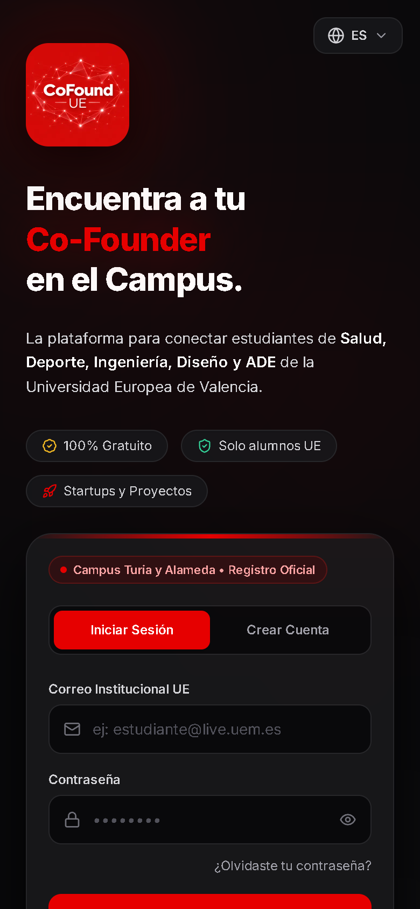
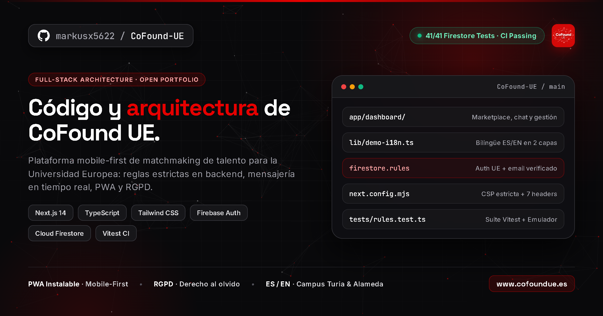
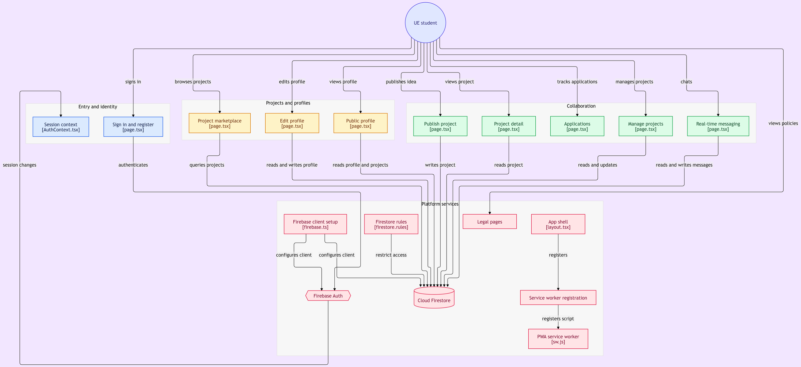
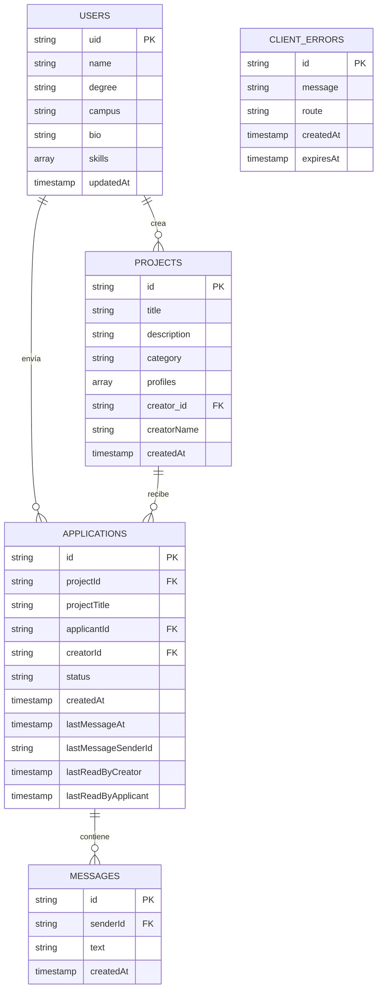

```mermaid
flowchart TD
 
subgraph group_identity["Identity &amp; access"]
  node_login["Sign in / register<br/>[page.tsx]"]
  node_authctx["Auth state<br/>[AuthContext.tsx]"]
  node_guard["Protected routes<br/>[ProtectedRoute.tsx]"]
  node_authsvc{{"Firebase Auth"}}
end
 
subgraph group_collaboration["Project collaboration"]
  node_market["Project marketplace<br/>[page.tsx]"]
  node_newproject["Publish project<br/>[page.tsx]"]
  node_projectdetail["Project details<br/>[page.tsx]"]
  node_applications["My applications<br/>[page.tsx]"]
  node_myprojects["Manage projects<br/>[page.tsx]"]
  node_messages["Direct messaging<br/>[page.tsx]"]
end
 
subgraph group_people["Student profiles"]
  node_profileedit["Edit profile<br/>[page.tsx]"]
  node_publicprofile["View profile<br/>[page.tsx]"]
end
 
subgraph group_platform["App experience"]
  node_firestore[("Cloud Firestore")]
  node_rules["Firestore access rules<br/>[firestore.rules]"]
  node_firebaseclient["Firebase client<br/>[firebase.ts]"]
  node_pwa["PWA manifest<br/>[manifest.ts]"]
  node_swregister["Service worker registration"]
  node_serviceworker["Static asset caching<br/>[sw.js]"]
end
 
node_student(("UE student"))
 
node_student -->|"opens"| node_login
node_login -->|"signs in or registers"| node_authsvc
node_authsvc -->|"notifies auth state"| node_authctx
node_authctx -->|"provides session"| node_guard
node_student -->|"browses projects"| node_market
node_market -->|"uses client"| node_firebaseclient
node_market -->|"queries projects"| node_firestore
node_student -->|"publishes idea"| node_newproject
node_newproject -->|"writes project"| node_firestore
node_market -->|"opens project"| node_projectdetail
node_projectdetail -->|"reads project and applies"| node_firestore
node_student -->|"tracks applications"| node_applications
node_applications -->|"reads application status"| node_firestore
node_student -->|"manages projects"| node_myprojects
node_myprojects -->|"reads and updates records"| node_firestore
node_myprojects -->|"opens applicant chat"| node_messages
node_messages -->|"reads and sends messages"| node_firestore
node_messages -->|"updates read markers"| node_firestore
node_student -->|"maintains profile"| node_profileedit
node_profileedit -->|"reads and saves profile"| node_firestore
node_student -->|"views student"| node_publicprofile
node_publicprofile -->|"reads profile and projects"| node_firestore
node_firebaseclient -->|"configures client"| node_authsvc
node_firebaseclient -->|"configures client"| node_firestore
node_rules -->|"controls access"| node_firestore
node_pwa -->|"enables installation"| node_student
node_swregister -->|"registers"| node_serviceworker
node_serviceworker -->|"caches static assets"| node_student
 
click node_login "https://github.com/markusx5622/CoFound-UE/blob/main/app/page.tsx"
click node_authctx "https://github.com/markusx5622/CoFound-UE/blob/main/context/AuthContext.tsx"
click node_guard "https://github.com/markusx5622/CoFound-UE/blob/main/components/ProtectedRoute.tsx"
click node_market "https://github.com/markusx5622/CoFound-UE/blob/main/app/dashboard/page.tsx"
click node_newproject "https://github.com/markusx5622/CoFound-UE/blob/main/app/dashboard/nuevo/page.tsx"
click node_projectdetail "https://github.com/markusx5622/CoFound-UE/blob/main/app/dashboard/proyecto/%5Bid%5D/page.tsx"
click node_applications "https://github.com/markusx5622/CoFound-UE/blob/main/app/dashboard/mis-postulaciones/page.tsx"
click node_myprojects "https://github.com/markusx5622/CoFound-UE/blob/main/app/dashboard/mis-proyectos/page.tsx"
click node_messages "https://github.com/markusx5622/CoFound-UE/blob/main/app/dashboard/mensajes/page.tsx"
click node_profileedit "https://github.com/markusx5622/CoFound-UE/blob/main/app/perfil/page.tsx"
click node_publicprofile "https://github.com/markusx5622/CoFound-UE/blob/main/app/perfil/%5Buid%5D/page.tsx"
click node_rules "https://github.com/markusx5622/CoFound-UE/blob/main/firestore.rules"
click node_firebaseclient "https://github.com/markusx5622/CoFound-UE/blob/main/lib/firebase.ts"
click node_pwa "https://github.com/markusx5622/CoFound-UE/blob/main/app/manifest.ts"
click node_swregister "https://github.com/markusx5622/CoFound-UE/blob/main/components/ServiceWorkerRegister.tsx"
click node_serviceworker "https://github.com/markusx5622/CoFound-UE/blob/main/public/sw.js"
 
classDef toneNeutral fill:#f8fafc,stroke:#334155,stroke-width:1.5px,color:#0f172a
classDef toneBlue fill:#dbeafe,stroke:#2563eb,stroke-width:1.5px,color:#172554
classDef toneAmber fill:#fef3c7,stroke:#d97706,stroke-width:1.5px,color:#78350f
classDef toneMint fill:#dcfce7,stroke:#16a34a,stroke-width:1.5px,color:#14532d
classDef toneRose fill:#ffe4e6,stroke:#e11d48,stroke-width:1.5px,color:#881337
classDef toneIndigo fill:#e0e7ff,stroke:#4f46e5,stroke-width:1.5px,color:#312e81
classDef toneTeal fill:#ccfbf1,stroke:#0f766e,stroke-width:1.5px,color:#134e4a
class node_login,node_authctx,node_guard,node_authsvc toneBlue
class node_market,node_newproject,node_projectdetail,node_applications,node_myprojects,node_messages toneAmber
class node_profileedit,node_publicprofile toneMint
class node_firestore,node_rules,node_firebaseclient,node_pwa,node_swregister,node_serviceworker toneRose
class node_student toneIndigo
```

<div align="center">

  

  <br/><br/>

  ### *La Plataforma Exclusiva de Co-Founders y Talento para la Universidad Europea*

  [](https://www.cofoundue.es)
  [](#-pruebas-testing)
  [](https://nextjs.org/)
  [](https://www.typescriptlang.org/)
  [](https://tailwindcss.com/)
  [](https://firebase.google.com/)
  [](LICENSE)

  🇬🇧 [English version available](README.en.md)

  <p align="center">
    <strong>Conecta con estudiantes de Ingeniería, Datos, Diseño, ADE, Marketing, Derecho, Salud y Deporte para transformar ideas universitarias en proyectos reales.</strong>
  </p>

  [Vista en Vivo](#-vista-en-vivo-y-acceso-rápido) •
  [Características](#-características-principales) •
  [Arquitectura](#-arquitectura-del-proyecto) •
  [Flujo](#-flujo-de-la-aplicación) •
  [Vídeo](#-vídeo-de-presentación-1-min) •
  [Instalación](#-instalación-y-configuración-local) •
  [Testing](#-pruebas-testing) •
  [Roadmap](#-roadmap)

  ---

</div>

> [!TIP]
> **Plataforma en producción:** **CoFound UE** está operativa en **[www.cofoundue.es](https://www.cofoundue.es)** para el piloto en **Campus Turia y Campus Alameda** (Universidad Europea de Valencia), accesible exclusivamente con correos `@live.uem.es` y `@universidadeuropea.es`.

## 📌 Visión General

En un campus con cientos de estudiantes, la realidad operativa es que los equipos de trabajo se acaban formando por pura proximidad en el aula, no por afinidad de habilidades. El talento de ADE, Ingeniería, Salud y Deporte, Marketing, Diseño y Tech convive entre los campus de Turia y Alameda, pero rara vez llega a cruzarse de forma productiva. Las grandes ideas nacen a diario en la universidad, pero terminan enfriándose en grupos de chat inactivos por falta de los perfiles técnicos, sanitarios o de negocio adecuados para ejecutarlas.

Ante esta fricción, nace **CoFound UE**: una plataforma web full-stack diseñada específicamente para romper los silos académicos de la **Universidad Europea**. La aplicación funciona como un *marketplace* interno de talento que permite a estudiantes y graduados encontrarse de forma estratégica, colaborar en proyectos interdisciplinares, publicar retos académicos, encontrar socios para el Trabajo de Fin de Grado (TFG) o lanzar *startups* reales directamente desde el campus.

### 🔑 Propuesta de Valor
* **Exclusividad Institucional:** Autenticación estricta restringida a dominios de la universidad (`@live.uem.es` y `@universidadeuropea.es`).
* **Matchmaking por Habilidades:** Conexión estratégica entre creadores de ideas e integradores técnicos o de negocio.
* **Formatos Flexibles:** Proyectos categorizados en *Retos Académicos*, *TFGs* y *Startups Reales*.
* **Experiencia de Usuario Inmersiva:** Interfaz en modo oscuro moderna con animaciones dinámicas de partículas en tiempo real mediante canvas interactivo.

---

## 📱 Vista en Vivo y Acceso Rápido

<table align="center">
  <tr>
    <td align="center" width="44%">
      
      <br/>
      <sub><strong>Captura real mobile-first</strong> · iOS / Android PWA</sub>
    </td>
    <td align="center" width="56%">
      
      <br/><br/>
      <strong><a href="https://www.cofoundue.es">www.cofoundue.es</a></strong>
      <br/><br/>
      <sub>
        • Acceso verificado: <code>@live.uem.es</code> y <code>@universidadeuropea.es</code><br/>
        • Interfaz y escaparate bilingües <strong>ES / EN</strong> en 2 capas<br/>
        • Chat privado <strong>1 a 1</strong> en tiempo real · 100 % gratuita<br/>
        • Redes: <a href="https://www.instagram.com/cofoundue/">Instagram (@cofoundue)</a> · <a href="https://www.linkedin.com/company/cofound-ue/">LinkedIn (CoFound UE)</a>
      </sub>
    </td>
  </tr>
</table>

---

## ✨ Características Principales

| Módulo | Descripción | Tecnología Clave |
| :--- | :--- | :--- |
| **🛡️ Auth Restringida** | Registro e inicio de sesión validado para correos institucionales de la Universidad Europea con verificación de email obligatoria (hard-gate en interfaz y en reglas de Firestore), toggle de visibilidad de contraseña, protección contra enumeración de correos y API Key restringida por dominio y APIs. | Firebase Auth, GCP API Restrictions & TypeScript regex |
| **🎨 Interfaz Inmersiva** | Estética *dark-mode* moderna con canvas de partículas fluidas (optimizado también en móvil respetando `prefers-reduced-motion`), cuadrícula `2×2` de ecuaciones de equipo Turia × Alameda, efectos glassmorphism y acentos institucionales UE (`#E60000`). | Tailwind CSS, Framer Motion & HTML5 Canvas |
| **👤 Perfiles de Estudiantes** | Gestión completa del perfil del alumno con avatares de iniciales generados localmente, banner de onboarding, chips rápidos de habilidades, enlace a perfil público, validación de perfil completo antes de postularse y selección de campus (Turia y Alameda durante el piloto). | Firestore Document Merge, InitialsAvatar & Sonner Toasts |
| **💡 Marketplace de Proyectos** | Tablero en tiempo real con buscador limpiable, contador de resultados, filtro de categoría y *Ocultar ejemplos*, botón de compartir, y escaparate oficial (`demo-cofound-ue`) con badge `Ejemplo` protegido en reglas contra postulaciones. | Firestore Queries & Lucide Icons |
| **📝 Creador de Proyectos** | Publicador de ideas con categorización, plantilla guiada de descripción y chips rápidos para definir perfiles buscados (*ej: Frontend Developer, Growth Hacker, Fisioterapeuta*). | Controlled Dynamic Forms |
| **🤝 Postulaciones & Matching** | Modal de presentación (`ApplyProjectModal`) que envía la solicitud junto con el primer mensaje al chat mediante `writeBatch` atómico, prevención de autopostulaciones/duplicados, retirada de postulación pendiente y `ConfirmModal` propio. | Firestore Atomic Batches & Realtime Collections |
| **💬 Mensajería en tiempo real** | Chat directo entre creador y postulante con acceso restringido en reglas, marcas de hora y fechas relativas, badges de estado en vivo y enlace directo al proyecto desde la cabecera del chat. | Firestore Subcollections & Realtime Listeners (`onSnapshot`) |
| **📂 Gestión Personal** | Paneles dedicados para administrar *Mis Proyectos* creados (con acceso directo a editar) y monitorear o retirar solicitudes desde *Mis Postulaciones*. | Protected Route System |
| **🌐 Internacionalización (ES/EN)** | Interfaz bilingüe con diccionarios tipados y traducción de proyectos en 2 capas: localización nativa al inglés para el escaparate oficial y su búsqueda (`Capa 1`), más botón de traducción bajo demanda sin dependencias en proyectos reales (`Capa 2`). | React Context (`LanguageContext`), `demo-i18n.ts` & Typed Dictionaries |
| **🔒 Privacidad RGPD & Derecho al Olvido** | Ocultación de emails en perfiles públicos, consentimiento afirmativo en registro y eliminación integral de cuenta previa reautenticación con borrado en cascada de proyectos, postulaciones y mensajes. | Firestore Security Rules & Cascading Deletes |
| **📲 PWA Instalable** | Instalación en pantalla de inicio (móvil y escritorio) con iconos maskable, service worker propio, experiencia standalone y prompt de instalación no invasivo (máximo una vez por sesión, descarte persistente de 30 días, detección de modo standalone). | Web App Manifest & Service Worker |

---

## 🛠️ Stack Tecnológico

### Frontend & UI
* **[Next.js 14](https://nextjs.org/) (App Router):** Framework React para renderizado optimizado, routing basado en el sistema de archivos y metadatos SEO dinámicos.
* **[TypeScript](https://www.typescriptlang.org/):** Tipado estático estricto para garantizar robustez en props, estado y contratos con la base de datos.
* **[Tailwind CSS](https://tailwindcss.com/):** Framework de CSS utility-first adaptado con tokens de diseño personalizados, utilidades de filtrado y animaciones.
* **[Framer Motion](https://www.framer.com/motion/):** Librería para animaciones fluidas, transiciones de interfaz y microinteracciones dinámicas.
* **[Lucide React](https://lucide.dev/):** Conjunto de iconos vectoriales ligeros y consistentes.
* **[Sonner](https://sonner.emilkowal.ski/):** Sistema de notificaciones toast elegantes y accesibles.

### Backend & Servicios
* **[Firebase Auth](https://firebase.google.com/docs/auth):** Manejo de autenticación basada en email y contraseña con control de errores localizado en español e inglés (ES/EN).
* **[Cloud Firestore](https://firebase.google.com/docs/firestore):** Base de datos NoSQL escalable para el almacenamiento en tiempo real de usuarios, proyectos, postulaciones y mensajes.
* **[Vercel & Analytics](https://vercel.com/):** Plataforma de despliegue continuo optimizada para Next.js con monitorización de rendimiento y analíticas en tiempo real.

---

## 📂 Arquitectura del Proyecto

<p align="center">
  
</p>

<details>
<summary><strong>Ver árbol completo de directorios y módulos del repositorio</strong></summary>

```
CoFound-UE/
├── .github/                              # Automatización y flujos de trabajo de GitHub
│   └── workflows/
│       └── ci.yml                        # Pipeline CI: lint, tests con emulador, build
├── app/                                  # Rutas y páginas principales (Next.js App Router)
│   ├── dashboard/                        # Panel principal del estudiante (Marketplace de proyectos)
│   │   ├── mensajes/                     # Chat y mensajería en tiempo real entre creadores y postulantes
│   │   ├── mis-postulaciones/            # Rastreador de postulaciones enviadas
│   │   ├── mis-proyectos/                # Gestor de proyectos creados por el usuario
│   │   ├── nuevo/                        # Formulario para publicar una nueva idea/proyecto
│   │   ├── proyecto/[id]/                # Vista detallada de un proyecto y botón de postulación
│   │   │   ├── editar/                   # Formulario de edición de proyectos existentes
│   │   │   │   └── page.tsx              # Vista de edición protegida
│   │   │   └── page.tsx                  # Detalle del proyecto y postulación
│   │   └── page.tsx                      # Vista de Proyectos Activos (Dashboard central)
│   ├── legal/                            # Cumplimiento normativo y aviso legal
│   │   ├── aviso-legal/                  # Documentación de Términos y Condiciones
│   │   ├── cookies/                      # Política de Cookies
│   │   └── privacidad/                   # Política de Privacidad de Datos
│   ├── perfil/                           # Perfil universitario del estudiante
│   │   ├── [uid]/                        # Vista de perfil público de otros estudiantes
│   │   └── page.tsx                      # Gestión de datos personales, campus, habilidades y baja RGPD
│   ├── error.tsx                         # Boundary global de recuperación y telemetría de errores en cliente
│   ├── favicon.ico                       # Icono de la aplicación para rutas del App Router
│   ├── globals.css                       # Estilos globales y extensiones Tailwind
│   ├── layout.tsx                        # Estructura raíz con JSON-LD, fondo interactivo, PWA y Toaster
│   ├── manifest.ts                       # Generador de metadatos de la PWA (Web App Manifest)
│   ├── page.tsx                          # Landing Page con formulario de Login/Registro integrados
│   ├── robots.ts                         # Generador dinámico de robots.txt con host canónico
│   └── sitemap.ts                        # Generador dinámico de sitemap.xml con URLs canónicas
├── components/                           # Componentes de UI reutilizables
│   ├── ui/                               # Primitivas y componentes visuales base (Skeleton loaders)
│   ├── ApplyProjectModal.tsx             # Modal de presentación para postularse con primer mensaje automático
│   ├── campus-feed-preview.tsx           # Cuadrícula 2×2 de ecuaciones de equipo (Turia × Alameda)
│   ├── ConfirmModal.tsx                  # Modal de confirmación accesible (sustituye window.confirm)
│   ├── footer.tsx                        # Pie de página con enlaces legales y enlace al repositorio público en GitHub
│   ├── hero-section.tsx                  # Sección principal de bienvenida e impacto visual
│   ├── how-it-works.tsx                  # Guía paso a paso sobre el funcionamiento de la red
│   ├── InitialsAvatar.tsx                # Generador local de avatares con iniciales (privacidad por diseño)
│   ├── LanguageSelector.tsx              # Selector de idioma ES/EN con persistencia
│   ├── Navbar.tsx                        # Barra de navegación adaptativa con estado de usuario
│   ├── particle-background.tsx           # Canvas HTML5 con efecto matricial de partículas (desktop y móvil ligero)
│   ├── ProtectedRoute.tsx                # Guardián de rutas privadas con hard-gate de email verificado
│   ├── PwaInstallPrompt.tsx              # Popup de instalación PWA no invasivo (sesión, descarte 30d, standalone)
│   ├── ServiceWorkerRegister.tsx         # Registro del Service Worker PWA en entornos de producción
│   └── student-faq.tsx                   # FAQ para estudiantes en la Landing
├── context/                              # Contextos globales de React
│   ├── AuthContext.tsx                   # Proveedor y hook de autenticación de usuario
│   └── LanguageContext.tsx               # Proveedor y hook de internacionalización (ES/EN)
├── lib/                                  # Lógica de negocio, diccionarios i18n y utilidades
│   ├── i18n/                             # Diccionarios tipados para soporte bilingüe (ES/EN)
│   │   ├── en.ts                         # Traducciones al inglés (tipado estricto)
│   │   └── es.ts                         # Traducciones al español (fuente canónica y tipo Dictionary)
│   ├── auth-errors.ts                    # Mapeo de errores de Firebase Auth a claves i18n
│   ├── categories.ts                     # Categorías canónicas de proyectos y traducción
│   ├── date-utils.ts                     # Formateo de fechas relativas y horas de chat (ES/EN)
│   ├── demo.ts                           # Constantes y helpers del escaparate oficial (demo-cofound-ue)
│   ├── demo-i18n.ts                      # Capa 1 (localización nativa demo) y Capa 2 (traducción bajo demanda)
│   ├── error-logger.ts                   # Telemetría nativa de errores de cliente hacia Firestore (sin PII)
│   ├── firebase.ts                       # Inicialización del SDK de Firebase, Auth y Firestore
│   ├── firestore-guards.ts               # Helpers de saneamiento y borrado seguro en Firestore
│   └── site.ts                           # Constante SITE_URL, única fuente de verdad del dominio canónico
├── public/                               # Recursos estáticos y PWA
│   ├── icons/                            # Iconos PWA responsivos y maskable para dispositivos
│   ├── CoFoundUE_banner.png              # Banner de marca (README / landing)
│   ├── CoFoundUE_logo.png                # Logotipo oficial de CoFound UE
│   ├── Diagrama_CoFoundUE.png            # Diagrama de flujo de arquitectura (optimizado a ~272 KB)
│   ├── favicon.ico                       # Favicon público de la plataforma
│   ├── og-image.jpg                      # Imagen OpenGraph optimizada para previsualizaciones (1200x630)
│   └── sw.js                             # Service Worker para capacidades PWA y caché offline
├── scripts/                              # Utilidades locales y sincronización de escaparate
│   ├── demo-showcase-data.mjs            # Dataset oficial del escaparate (perfil + 6 proyectos ejemplo)
│   ├── seed-database.mjs                 # Sembrado de proyectos de ejemplo (exclusivo emulador local, con --dry-run)
│   └── sync-demo-showcase.mjs            # Sincronizador del escaparate oficial (dry-run por defecto, --apply-prod)
├── tests/                                # Suite de pruebas automatizadas
│   └── rules.test.ts                     # 41 tests de reglas Firestore con Vitest y emulador local
├── .eslintrc.json                        # Configuración de ESLint (next/core-web-vitals)
├── .nvmrc                                # Versión de Node.js fijada para desarrollo y CI (Node 20)
├── CoFound UE — Protocolo de Smoke Test.md # Protocolo de pruebas pre-piloto (v2.1)
├── firebase.json                         # Configuración de Firebase y emuladores locales
├── firestore.indexes.json                # Definición de índices compuestos de Firestore
├── firestore.rules                       # Reglas de seguridad de Firestore (email verificado, bloqueo demo-* y mensajería)
├── LICENSE                               # Licencia propietaria (Todos los derechos reservados)
├── next.config.mjs                       # Config Next.js: redirect 308 a www.cofoundue.es, 7 cabeceras de seguridad, CSP estricta y headers SW
├── package.json                          # Dependencias, scripts, engines y metadatos
├── postcss.config.mjs                    # Plugins de procesamiento CSS (Autoprefixer, Tailwind)
├── tailwind.config.ts                    # Configuración del tema Tailwind
└── tsconfig.json                         # Reglas del compilador de TypeScript
```

</details>

## 🎬 Vídeo de Presentación (1 min)
 
https://github.com/user-attachments/assets/92791c3f-0542-4e74-bb1a-12d377bbf628

<br/>

## 🔄 Flujo de la Aplicación
 
El siguiente diagrama traza el recorrido funcional del estudiante a través de la plataforma, agrupado por dominio (identidad, colaboración en proyectos, perfiles y experiencia de la app), junto con los ficheros que implementan cada nodo. Se muestra como imagen pre-renderizada porque el grafo tiene demasiadas conexiones cruzadas de largo alcance para que el motor de layout de Mermaid lo ajuste con fidelidad al ancho fijo del visor de GitHub; el código fuente sigue disponible más abajo para poder editarlo:
 
<p align="center">
  
</p>

---

<details>
<summary>Ver código fuente Mermaid (para editarlo o regenerar la imagen)</summary>
  

 
</details>


---

## ⚡ Instalación y Configuración Local

Sigue estos pasos para ejecutar **CoFound UE** en tu entorno local:

### 1. Prerrequisitos
Asegúrate de tener instalados:
* **Node.js**: Versión `20.x` (fijada en `.nvmrc` y `package.json`) o superior.
* **npm**, **yarn**, **pnpm** o **bun**.

### 2. Clonar el Repositorio
```bash
git clone https://github.com/markusx5622/CoFound-UE.git
cd CoFound-UE
```

### 3. Instalar Dependencias
```bash
npm install
```

### 4. Configurar Variables de Entorno
Crea un archivo `.env.local` en la raíz del proyecto y añade tus credenciales de **Firebase**:

```env
NEXT_PUBLIC_FIREBASE_API_KEY=tu_firebase_api_key
NEXT_PUBLIC_FIREBASE_AUTH_DOMAIN=tu_proyecto.firebaseapp.com
NEXT_PUBLIC_FIREBASE_PROJECT_ID=tu_proyecto_id
NEXT_PUBLIC_FIREBASE_STORAGE_BUCKET=tu_proyecto.appspot.com
NEXT_PUBLIC_FIREBASE_MESSAGING_SENDER_ID=tu_messaging_sender_id
NEXT_PUBLIC_FIREBASE_APP_ID=tu_app_id
```

### 5. Iniciar el Servidor de Desarrollo
```bash
npm run dev
```
Abre tu navegador y entra en [http://localhost:3000](http://localhost:3000).

---

## 💾 Modelo de Datos (Firestore)

El proyecto organiza sus datos en **Firebase Firestore** estructurados en colecciones principales y la subcolección de mensajería en tiempo real:



---

## 📜 Scripts Disponibles

En el directorio del proyecto, puedes ejecutar:

| Comando | Descripción |
| :--- | :--- |
| `npm run dev` | Inicia la aplicación en modo desarrollo con Hot Module Replacement (HMR). |
| `npm run build` | Compila la aplicación optimizada para producción en el directorio `.next`. |
| `npm run start` | Inicia un servidor de producción de Next.js. |
| `npm run lint` | Ejecuta el linter de ESLint (`next/core-web-vitals`, configurado en `.eslintrc.json`) para detectar errores de código y estilo. |
| `npm test` | Ejecuta la suite de tests de reglas de Firestore con Vitest (requiere el emulador). |
| `node scripts/seed-database.mjs` | Carga perfiles y proyectos de ejemplo en el emulador local de Firestore (bloqueado contra producción; soporta `--dry-run`). |
| `node scripts/sync-demo-showcase.mjs` | Sincroniza el escaparate oficial (`demo-cofound-ue` + 6 proyectos ejemplo). Ejecuta `--dry-run` por defecto; requiere `--apply-prod` y `GOOGLE_APPLICATION_CREDENTIALS` para escribir en producción. |

---

## 🧪 Pruebas (Testing)

El proyecto cuenta con un entorno de pruebas unitarias configurado con **Vitest** y el Emulador local de Firestore para validar rigurosamente las reglas de seguridad (`firestore.rules`). La suite actual consta de **41 tests** que validan control de acceso, bloqueo de listado masivo de usuarios (`allow list: if false`), dominio institucional obligatorio en backend, protección RGPD de emails y migración de perfiles heredados, anti-suplantación y cierre de chat en postulaciones rechazadas, integridad referencial y unicidad determinista (`{projectId}_{applicantId}`), bloqueo de postulaciones a proyectos oficiales `demo-*`, flujo de postulación con mensaje inicial atómico y retirada de postulación pendiente, ciclo E2E completo de 4 cuentas, validación estricta de elementos en arrays y timestamps (`request.time`), esquemas cerrados (`keys().hasOnly`), retención TTL en errores de cliente y el bloqueo de usuarios sin email verificado.

### Ejecutar tests localmente
Asegúrate de haber instalado las dependencias (`npm install`). Para lanzar el emulador y correr la suite de tests, ejecuta:
```bash
npx --yes firebase-tools emulators:exec --only firestore --project cofound-ue-test "npm test"
```

El pipeline de CI en GitHub Actions ejecutará esta suite automáticamente en cada `push` a la rama `main`.

---

## 🔒 Políticas de Seguridad y Validación Auth

La aplicación incluye un motor de validación para proteger el ecosistema universitario:

1. **Email Institucional Mandatorio:**
   Se requiere que el correo introducido al iniciar sesión o registrarse finalice formalmente en:
   - `@live.uem.es` *(Alumnos)*
   - `@universidadeuropea.es` *(Personal / Docentes)*
2. **Rutas Protegidas (`ProtectedRoute.tsx`):**
   Las vistas internas (`/dashboard`, `/perfil`, `/dashboard/nuevo`, `/dashboard/proyecto/[id]`, `/dashboard/mensajes`, etc.) verifican la sesión activa en Firebase Auth antes de conceder acceso, redirigiendo automáticamente a la Landing Page si el usuario no se encuentra autenticado. Además, exige email verificado como puerta obligatoria (hard-gate): si `user.emailVerified == false`, bloquea TODA la interfaz interna con pantalla de verificación, reenvío de correo con cooldown de 60s y manejo de `auth/too-many-requests`.
3. **Reglas de Seguridad Estrictas (`firestore.rules`):**
   Acceso granular en Firestore: usuarios solo editan su propio perfil (prohibiendo inyectar o alterar el campo `email` en documentos públicos y limpiando automáticamente cualquier `email` heredado al guardar), creadores gestionan sus proyectos, y la subcolección de mensajes está estrictamente restringida a los dos participantes de la postulación (creador y postulante), bloqueando cualquier acceso cruzado no autorizado. Desplegado en producción, `isAuthenticated()` exige `request.auth.token.email_verified == true`: un usuario sin verificar queda bloqueado también ante peticiones directas vía SDK/API REST; y las reglas validan campos en escritura: título 3–100 chars, descripción 20–1500, 1–10 perfiles, `creatorName` obligatorio, mensajes 1–1000 chars.
4. **Cobertura Automatizada en CI:**
   La suite de **41 tests** (`tests/rules.test.ts`, Vitest + emulador) cubre control de acceso por rol/participante, prohibición de volcado masivo de perfiles, validación de dominio institucional en reglas, protección y migración del campo `email` en perfiles, anti-suplantación y bloqueo de chat tras rechazo, integridad referencial y unicidad determinista en postulaciones, bloqueo de postulaciones a `demo-*`, postulación con mensaje inicial atómico y retirada pendiente, ciclo E2E de 4 cuentas, tipado de elementos de arrays y timestamps, esquemas cerrados (`keys().hasOnly`), envío atómico de mensajes, TTL en telemetría y bloqueo total de usuarios sin email verificado. CI la ejecuta en cada push a main.
5. **Endurecimiento de Producción (Fase 3):**
   API Key del navegador en Google Cloud restringida a 4 orígenes autorizados y 4 APIs de Firebase, protección contra enumeración de correos y política de contraseñas (mínimo 8 caracteres) activas en Firebase Auth, junto con 7 cabeceras HTTP de seguridad y Content-Security-Policy (CSP) estricta en `next.config.mjs`.

---

## 🌐 Despliegue

La plataforma está optimizada para ser desplegada en **Vercel** o plataformas compatibles con Next.js:

1. Conecta tu repositorio de GitHub con **Vercel**.
2. En la configuración del proyecto, agrega las variables de entorno de Firebase (`NEXT_PUBLIC_FIREBASE_*`).
3. Vercel detectará automáticamente Next.js 14 y ejecutará la compilación.

URL de producción activa: **[https://www.cofoundue.es](https://www.cofoundue.es)**

---

## 🗺️ Roadmap

El desarrollo de **CoFound UE** se organiza en fases estratégicas orientadas a consolidar la plataforma y responder a las necesidades reales del campus:

* **Completado:**
  * **Fase 0:** Auth institucional (`@live.uem.es` / `@universidadeuropea.es`), reglas de seguridad de Firestore y borrado de proyectos en cascada.
  * **Fase 1:** Marketplace de proyectos, sistema de postulaciones y perfiles universitarios.
  * **Fase 2:** Mensajería en tiempo real, perfiles de usuario y *skeleton loaders*.
  * **Fase 3A:** PWA instalable, dominio custom (`www.cofoundue.es`), SEO técnico (Sitemap, Robots) y CI con tests automatizados de reglas Firestore.
  * **Fase 3B:** Hardening de seguridad (email verificado exigido en reglas y hard-gate de interfaz), unificación SEO al dominio canónico `www.cofoundue.es` (metadataBase, og:url, canonical, redirect 308 desde el subdominio de Vercel), limpieza de assets huérfanos (−8,2 MB), prompt PWA no invasivo, y ampliación del piloto a los campus Turia y Alameda.
  * **Fase 3C:** Internacionalización completa ES/EN con selector de idioma y diccionarios tipados, privacidad RGPD (ocultación de emails públicos, consentimiento afirmativo en registro, reautenticación previa al derecho al olvido en cascada y TTL de 30 días en diagnósticos), datos estructurados JSON-LD, ESLint bloqueante y Actions fijadas por SHA en CI, blindaje de reglas Firestore (dominio institucional en backend, bloqueo de volcado de usuarios, integridad referencial y unicidad determinista, tipado de arrays y `request.time`, esquemas cerrados `keys().hasOnly`, anti-suplantación y cierre de chat rechazado), Content-Security-Policy (CSP) y cabeceras HTTP de seguridad, y script de proyectos de ejemplo para emulador local.
  * **Fase 3D (Pre-Piloto):** Endurecimiento Fase 3 en consola (API Key restringida por origen/API y protección contra enumeración de correos), escaparate oficial `demo-cofound-ue` (badge `Ejemplo`, bloqueo en reglas y sincronizador dedicado), mejoras de UX/QoL (banner de onboarding, modal de presentación con primer mensaje automático, retirada de postulación pendiente, plantilla guiada, chips rápidos, `ConfirmModal`, visibilidad de contraseña, filtro *Ocultar ejemplos*, compartir y mejoras de chat), rediseño de Landing con representación Turia × Alameda (`2×2`), traducción de proyectos en 2 capas (`Capa 1` nativa + `Capa 2` bajo demanda sin dependencias), protocolo de Smoke Test v2.1 y suite ampliada a **41 tests**.

* **En curso / Próximas fases:**
  * Ejecución del smoke test v2.1 y lanzamiento del piloto en los campus Turia y Alameda.
  * Notificaciones transaccionales por email.
  * Buscador global avanzado de proyectos y talento.
  * Dashboard de métricas para creadores.

---

## 📬 Piloto en Campus Turia y Alameda y Contacto

Cabe destacar que CoFound UE nace bajo la exigente filosofía del *learning by doing* de nuestra universidad. Por lo tanto, el despliegue inicial de la plataforma se plantea como un **piloto en ambos campus presenciales de Valencia (Turia —Guillem de Castro 175— y Alameda —Paseo de la Alameda 7—)** durante este cuatrimestre. Los dos campus están a 20-25 min a pie y forman un único mercado de talento, permitiendo asegurar la calidad del *matchmaking* y garantizar que los primeros usuarios extraigan un valor real e inmediato para sus proyectos y asignaturas.

Para evaluar la tracción y viabilidad del producto en este entorno real, el piloto se regirá por KPIs estratégicos muy claros. En este sentido, monitorizaremos semanalmente la tasa de usuarios activos (WAU), el ratio de conversión de postulaciones (solicitudes enviadas vs. equipos cerrados) y el *Time-to-Match* (el tiempo medio que tarda una idea publicada en encontrar los perfiles que necesita).

No obstante, el éxito de cualquier producto digital reside en la iteración constante basada en el usuario final. Si eres estudiante y detectas alguna oportunidad de mejora, o si eres docente y quieres proponer el uso de la plataforma como dinámica oficial para formar equipos en tus clases, necesitamos escucharte. 

Tu feedback es vital para seguir escalando la herramienta con criterio. Puedes compartir tus impresiones, reportar incidencias o proponer alianzas estratégicas escribiendo directamente a: **cofoundue@gmail.com**

---

## 📄 Licencia

**Copyright © 2026 Marc Cubero Cantavella — Todos los derechos reservados.**

Este proyecto, incluyendo su código fuente, diseño, algoritmos y documentación, es propiedad intelectual exclusiva de su autor. No se concede ningún derecho de uso, copia, modificación, distribución o explotación sin autorización previa y por escrito. La presencia de este código en un repositorio público cumple una función estrictamente demostrativa y de portafolio profesional.

Consulta el archivo [`LICENSE`](./LICENSE) para obtener más detalles.

---

<div align="center">
  <sub>Desarrollado con ❤️ para la comunidad de la <strong>Universidad Europea</strong>.</sub>
</div>
